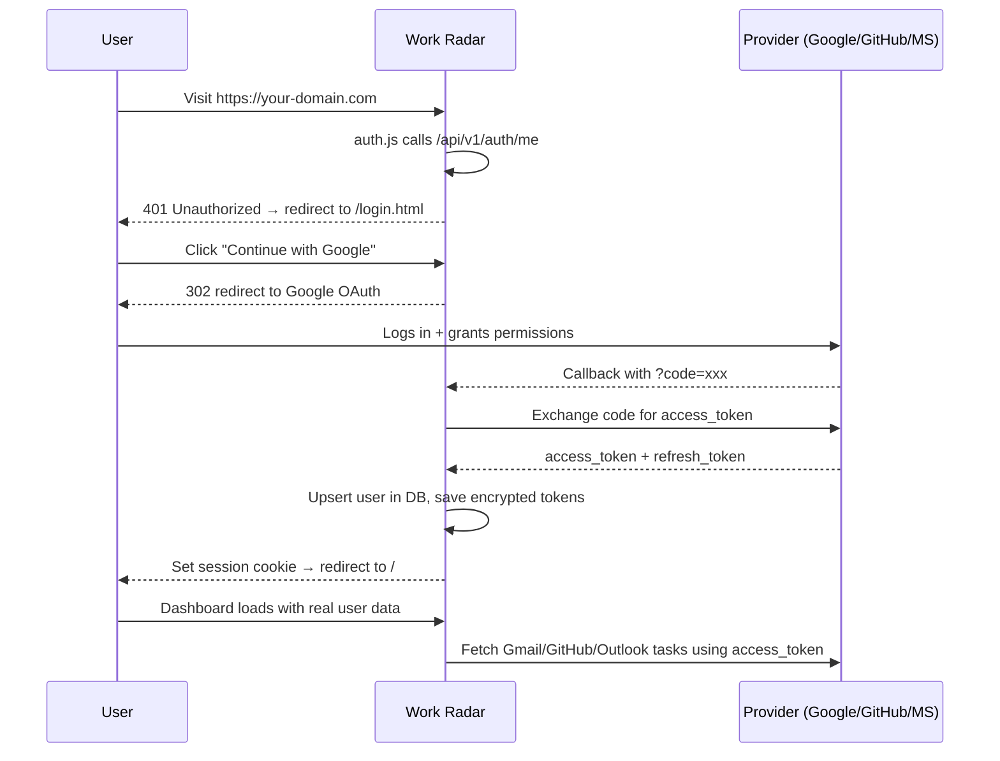

# 🔐 Work Radar — OAuth Setup Guide

> [!IMPORTANT]
> You must complete **at least one** of these three sections before real login works.
> In `NODE_ENV=development` the server skips auth entirely — OAuth only activates in production.

---

## 1. Google OAuth (Gmail extraction)

**Goal:** Log in with Google → Work Radar reads your Gmail for tasks.

### Steps

1. Go to **[Google Cloud Console](https://console.cloud.google.com/)** → Select / create a project.
2. Navigate to **APIs & Services → Library** and enable:
   - **Gmail API**
   - **Google People API** (or "Google+ API")
3. Go to **APIs & Services → Credentials → + Create Credentials → OAuth 2.0 Client ID**.
4. Application type: **Web application**. Give it a name (e.g. `Work Radar`).
5. Under **Authorized redirect URIs**, add:
   - `http://localhost:3000/api/v1/oauth/google/callback` ← local dev
   - `https://YOUR_DOMAIN.com/api/v1/oauth/google/callback` ← production
6. Click **Create** and copy the **Client ID** and **Client Secret**.

### .env values

```env
GOOGLE_CLIENT_ID=1234567890-abc.apps.googleusercontent.com
GOOGLE_CLIENT_SECRET=GOCSPX-xxxxxxxxxxxxxxxxxxxxxxxxx
```

> [!NOTE]
> If you get "This app isn't verified" on the Google consent screen, click **Advanced → Go to Work Radar (unsafe)** during development. For production, submit for Google verification.

---

## 2. GitHub OAuth

**Goal:** Log in with GitHub → Work Radar can read your Issues and PRs.

### Steps

1. Go to **[GitHub Developer Settings](https://github.com/settings/developers)** → **OAuth Apps → New OAuth App**.
2. Fill in:
   - **Application name**: `Work Radar`
   - **Homepage URL**: `http://localhost:3000` (or your production domain)
   - **Authorization callback URL**: `http://localhost:3000/api/v1/oauth/github/callback`
3. Click **Register application**.
4. Click **Generate a new client secret** and copy both values.

### .env values

```env
GITHUB_CLIENT_ID=Iv1.xxxxxxxxxxxxxxxx
GITHUB_CLIENT_SECRET=xxxxxxxxxxxxxxxxxxxxxxxxxxxxxxxxxxxxxxxx
```

---

## 3. Microsoft OAuth (Outlook / Teams)

**Goal:** Log in with Microsoft → Work Radar reads your Outlook inbox.

### Steps

1. Go to **[Azure Portal](https://portal.azure.com/)** → **Azure Active Directory → App registrations → + New registration**.
2. Fill in:
   - **Name**: `Work Radar`
   - **Supported account types**: `Accounts in any organizational directory (Any Azure AD directory - Multitenant) and personal Microsoft accounts`
   - **Redirect URI** (Web): `http://localhost:3000/api/v1/oauth/microsoft/callback`
3. Click **Register**.
4. Note the **Application (client) ID** — this is your `MICROSOFT_CLIENT_ID`.
5. Go to **Certificates & Secrets → + New client secret** → copy the **Value** (secret).
6. Go to **API Permissions → + Add a permission → Microsoft Graph → Delegated permissions** and add:
   - `openid`, `profile`, `email`, `offline_access`
   - `User.Read`
   - `Mail.Read`
7. Click **Grant admin consent** (or users can self-consent).

### .env values

```env
MICROSOFT_CLIENT_ID=xxxxxxxx-xxxx-xxxx-xxxx-xxxxxxxxxxxx
MICROSOFT_CLIENT_SECRET=xxxxxxxxxxxxxxxxxxxxxxxxxxxxxxxxxxxxx
MICROSOFT_TENANT_ID=common
```

> [!TIP]
> `MICROSOFT_TENANT_ID=common` allows both personal Microsoft accounts (Outlook.com) and work/school accounts (Office 365). Change it to your specific tenant ID to restrict to your organization only.

---

## 4. Add values to your `.env`

Edit `d:\C  --  DRIVE\Projects\Work Radar\.env` and fill in the values:

```env
# Required for production auth
NODE_ENV=production
APP_URL=https://your-deployed-domain.com

# Fill in at least one provider:
GOOGLE_CLIENT_ID=...
GOOGLE_CLIENT_SECRET=...

GITHUB_CLIENT_ID=...
GITHUB_CLIENT_SECRET=...

MICROSOFT_CLIENT_ID=...
MICROSOFT_CLIENT_SECRET=...
MICROSOFT_TENANT_ID=common
```

---

## 5. Update callback URLs for production

When you deploy (e.g. Render, Railway), update the redirect URIs in each provider console to add your **production URL**:

| Provider  | Production Callback URL |
|-----------|------------------------|
| Google    | `https://YOUR_DOMAIN/api/v1/oauth/google/callback` |
| GitHub    | `https://YOUR_DOMAIN/api/v1/oauth/github/callback` |
| Microsoft | `https://YOUR_DOMAIN/api/v1/oauth/microsoft/callback` |

---

## 6. How it works end-to-end



> [!NOTE]
> In `NODE_ENV=development` (local), the login page is **bypassed** and the demo user "Alex Mercer" is auto-injected. You only need OAuth credentials when deploying to production.
